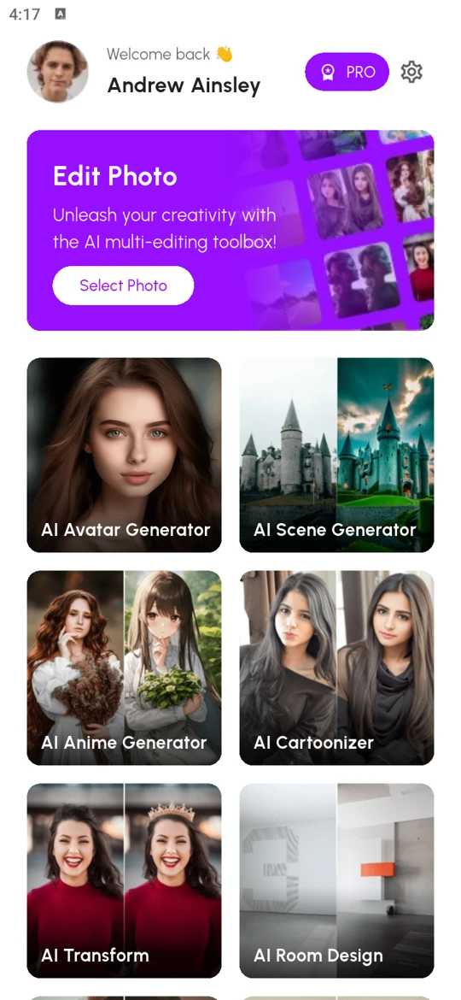
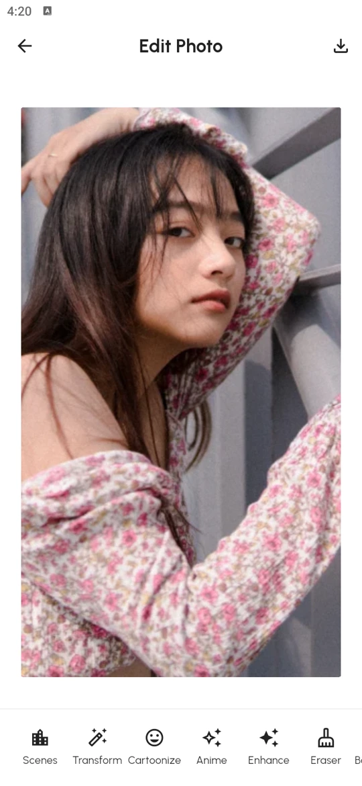
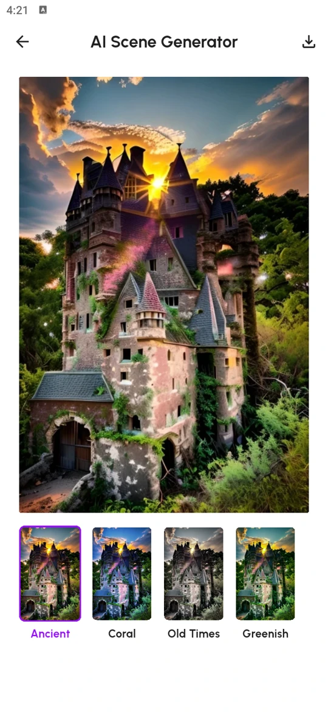
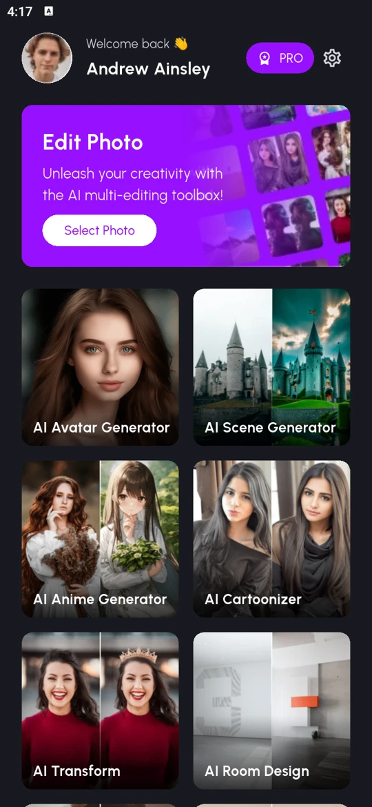

# Photofy · AI Photo Editor

Flutter Android 应用，界面参考 Pixso 的 **Photofy - AI Photo Editor App UI Kit**。通过 Pixso MCP 读取了 Light Theme、Dark Theme、Design System 三个分类。两套主题各有 90 个界面状态，完整导出可在 [Pixso 截图索引](docs/design/README.md) 中逐张查看。

## 运行

使用 Flutter **3.41.6**、Dart **3.11.4** 和已启动的 Android 模拟器。项目已通过 `.fvmrc` 指定 Flutter 版本。安装了 FVM 可在下列命令前加 `fvm`。

```powershell
flutter pub get
flutter devices
flutter run -d emulator-5554
```

Windows 上也可直接调用已有版本，例如 `& "$env:USERPROFILE\fvm\versions\3.41.6\bin\flutter.bat" run -d emulator-5554`。启动后跳过引导，选择 **Sign in with password**，输入有效格式的邮箱和至少 6 位的演示密码即可进入首页。通过 **Use Sample** 可以体验流程，也可通过 **Choose from Gallery** 读取设备上的照片。

## 模拟器截图

以下为现有 Android 11 模拟器中截取的 96 张界面中的四张。点击图片可查看原图。

| 工具首页 | 照片编辑器 | 场景预览 | 深色首页 |
| --- | --- | --- | --- |
| [](docs/screenshots/home-light.webp) | [](docs/screenshots/editor.webp) | [](docs/screenshots/scene-result.webp) | [](docs/screenshots/home-dark.webp) |

[浏览更多模拟器截图](docs/screenshots/README.md)

## 页面与设计对照

| Pixso 编号 | 业务流程 | Flutter 入口 |
| --- | --- | --- |
| 01–05 | 启动画面、三步引导、欢迎页 | `Intro`、`Welcome` |
| 06–17 | 登录、注册、验证码、密码重置及填写资料 | `Access` |
| 18–22 | 工具首页、编辑器、导出尺寸和保存反馈 | `Home`、`Editor` |
| 23–28 | 头像上传说明、导入多张、生成状态、结果列表、详情、分享 | `ToolFlow` 头像模式 |
| 29–43 | 场景、动漫、卡通、遮罩与文字变换 | `ToolFlow` |
| 44–55 | 室内设计、照片增强和局部擦除 | `ToolFlow` |
| 56–73 | 表情、发型、移除背景、更换背景和色彩预览 | `ToolFlow` |
| 74–82 | 设置、PRO 权益、方案、支付方式、确认及新增卡片 | `Settings` 和订阅页面 |
| 83–90 | 个人资料、安全、语言、帮助、隐私和退出确认 | 设置子页面 |
| 18 中的工具卡片 | 天空替换入口 | 复用背景工具的选图、配置和结果布局 |

## 项目结构与数据流

```text
lib/
├── main.dart                     应用入口、命名路由、主题注入
├── session.dart                  主题和演示账户状态
├── ui.dart                       Design System 对应的颜色、Urbanist 字体和公用组件
└── features/
    ├── access.dart               引导、欢迎、账号和重置流程
    ├── home.dart                 首页和工具入口
    ├── editor.dart               编辑、亮度、滤镜、裁切及分辨率导出
    ├── tools.dart                工具定义和滤镜参数
    ├── tool_flow.dart            选图、遮罩、配置、结果和头像交互
    ├── photo_data.dart           图片来源、预览、重采样、PNG 编码和设备桥接
    └── account.dart              设置、帮助、资料和演示订阅
android/app/src/main/             Flutter Android 宿主及系统相册桥接
assets/photofy/                   Pixso 图像资源和 Urbanist 字体
docs/design/                      Pixso 浅色、深色设计画板截图
docs/screenshots/                 Android 11 运行截图
test/widget_test.dart             登录、工具预览和主题切换测试
```

- `Session` 向各页面提供主题和账户状态。页面内的表单、工具步骤及裁切选项由对应的 Widget 管理。深色偏好保存在 Android 的 SharedPreferences。
- 首页和编辑器根据 `PhotoTool` 打开工具。常用流程复用同一套上传、配置和结果布局，头像流程使用列表和详情状态。
- 通过 `photofy/device` 方法通道打开 Android 图片选择器。导入图片复制到应用缓存，本地编辑通过 Flutter Canvas 渲染，Android 10 及以上通过 MediaStore 保存至 `Pictures/Photofy`，头像分享使用系统分享菜单。
- 亮度、滤镜、裁切、PNG 导出和增强对比预览在设备端运行。生成类工具的配置、遮罩和提示词用于演示交互，结果使用 Pixso 样图或用户原图预览。登录、验证码、订阅支付及安全设置为本地演示，语言选择记录当前会话的偏好。界面文案沿用设计稿的英文。

## 验证

```powershell
flutter analyze
flutter test
flutter build apk --debug --target-platform android-x64
```

在已运行的 Android 11 x64 模拟器 `emulator-5554` 验证登录、主题切换、图片导入及保存、工具预览和演示订阅。应用素材使用压缩 WebP，文档截图位于 `docs/`。
